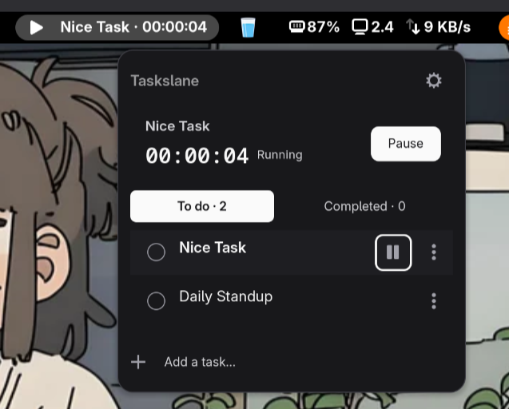
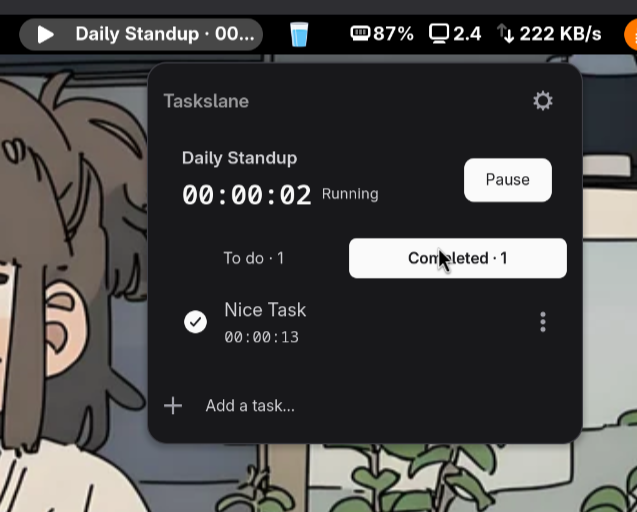

# Tasklane

A simple task timer for GNOME Shell.

Tasklane lives in your GNOME top bar, making it easy to track time while working on your tasks. Add a task, start the timer, and move on to the next one when you're done.

Everything runs locally. No accounts, subscriptions, or internet connection required.

## Screenshots

<!-- Put your screenshot files in screenshots/ using the filenames below,
     or replace the image paths with your own. -->







## Features

- Track time directly from the GNOME top bar.
- Quickly add tasks without opening another application.
- Start, pause, resume, and switch between tasks.
- Automatically start the next queued task when the current one is completed.
- Track accumulated time for each task.
- View completed tasks and reopen them when needed.
- Delete tasks and undo the most recent deletion.
- Choose between System, Light, and Dark themes.
- Control tasks using keyboard shortcuts.
- Keep tasks and tracked time across restarts.

Only one task can run at a time. Switching tasks automatically pauses the previous timer.

## Keyboard shortcuts

Shortcuts work while the Tasklane popup is open.

| Shortcut | Action |
|---|---|
| `Ctrl + N` | Focus the new task input |
| `Ctrl + Space` | Start, pause, or resume the timer |
| `Ctrl + Enter` | Complete the active task and start the next |
| `Ctrl + Z` | Undo the last deletion |
| `Enter` | Add a task when the input is focused |
| `Escape` | Close menus or return to the task list |

## Installation

### GNOME Extensions

Coming soon.

### Manual installation

Clone the repository:

```bash
git clone https://github.com/penerbangkode/Tasklane
cd tasklane
```

Install the extension:

```bash
gnome-extensions pack .
gnome-extensions install --force ./tasklane@penerbangkode.shell-extension.zip
```

The ZIP filename may differ depending on your extension metadata and packaging setup.

On GNOME Wayland, log out and log back in if necessary.

Enable Tasklane:

```bash
gnome-extensions enable tasklane@penerbangkode
```

Check your GNOME Shell version:

```bash
gnome-shell --version
```

See `metadata.json` for declared compatibility. Support for a specific version should be verified in a real GNOME session.

## Data and privacy

Tasklane stores everything locally in a JSON file.

By default, data is stored at:

```text
~/.local/share/tasklane/state.json
```

If `XDG_DATA_HOME` is configured, Tasklane uses that location instead.

If you're upgrading from Ticket Sprint, existing data from `ticket-sprint/state.json` is migrated automatically when the new state file doesn't exist. The original file is kept as a backup.

Tasklane doesn't collect analytics, send data to external services, or require an account.

## Timer behavior

Tasklane keeps an accumulated duration for each task.

Starting a different task pauses the current one and saves its elapsed time. Completing an active task automatically starts the next queued task.

When the extension is disabled normally, the running timer is paused and its progress is saved.

If your computer is suspended while the extension remains active, that time is included in the elapsed duration.

An unexpected GNOME Shell restart may also include time between the last saved timestamp and the next startup.

Automatic idle detection is not currently supported.

## Development

Run the automated tests with Node.js:

```bash
node tests/extension.test.cjs
```

Tests cover task management, timer behavior, persistence, theme settings, and UI interactions.

Automated tests use mocked GNOME Shell components. Native rendering, accessibility, and desktop integration should also be tested in a real GNOME session.

## Known limitations

- No automatic idle detection.
- No task editing or manual reordering.
- No Jira or other external integrations.
- No built-in data export.
- Keyboard shortcuts only work while the popup is open.

## Vibe coding disclaimer

Tasklane is a vibe-coded project developed with AI assistance. It may contain bugs or rough edges. Review the code and back up your task data before relying on it for important time tracking.

## Contributing

Bug reports, suggestions, and pull requests are welcome.

For larger changes, please open an issue first so we can discuss the approach.

## License

GPL-2.0-or-later.
